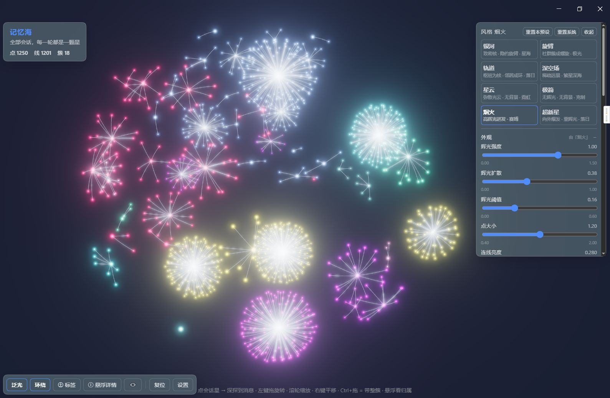
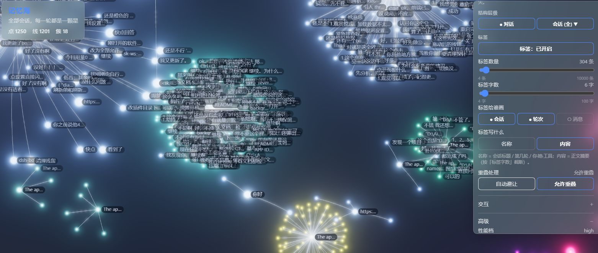

# 记忆海 · Memory Sea

**把你和 AI 的全部对话，长成一片可以游进去的星海。**

每一轮对话是一颗星，每一次深探，都能从一颗会话星一路钻到那条具体的消息。
星点之间的关系是真实的父子与共现关系，不是随机撒点。

DSH（DeepSeek Harness）插件 · WebGL / three.js · 只读，不碰你的对话内容

---


## 预览





<video src="[assets/Video.mp4](https://github.com/user-attachments/assets/a9409084-4cef-42f7-b41a-93ac77f1fee9)" controls=""></video>


- **点会话星** → 深探，把整棵树展开到每一条消息
- **Ctrl + 拖** → 抓着整簇走，子孙像绳子一样跟过来
- **悬浮** → 高亮它的归属链，其余压暗
- **Ctrl + 滚轮** → 镜头贴到那一簇

> 仓库里的 `src/demo.json` 是**虚构的示例数据**（芒果过敏、考试安排、日记……），
> 用来在没有真实数据时预览效果。它不含任何人的真实对话。

---


## 特性

| | |
|---|---|
| **四层结构** | 工作区 → 会话 → 轮次 → 消息。每一层都是一颗可以点的星 |
| **实时索引** | 后台扫你本机 DSH 的会话库，纯本地，不联网 |
| **一次深探到底** | 点会话星直接展开到消息，不用一层层点 |
| **GPU 生长动画** | 结构同步算完，新枝按批次"亮"出来，位置全程不动 |
| **屏幕空间拾取** | 1600 万次投影也不卡，且和 GPU 画出来的位置严格一致 |
| **过滤** | 按角色（你/她/工具/摘要）藏点，按层级（会话/对话）开关，按会话勾选 |
| **标签层** | 会话/轮次/消息可选写名称或正文，可避让、可重叠、上限 10000 条 |
| **8 套预设 + 6 套配色** | 银河、极光、深海……相机不会因为换预设而跳 |
| **观赏模式** | 只留一个按钮，四周全部隐去，纯看 |

---


## 安装

需要 DSH `0.2.x`。仓库内含构建好的 `lib/client.js`，**无需安装依赖或编译**。

### 方式一：从源码仓库

```bash
git clone https://github.com/Tan-TanZi/dsh-plugin-memory-sea.git ~/.dsh/plugins/dsh-plugin-memory-sea
```

Windows：

```powershell
git clone https://github.com/Tan-TanZi/dsh-plugin-memory-sea.git "$env:USERPROFILE\.dsh\plugins\dsh-plugin-memory-sea"
```

### 方式二：手动安装

全程不用命令行

**① 从源码仓库下载源码压缩包，解压放到插件目录：**

把整个 `dsh-plugin-memory-sea` 文件夹复制到：

```
%USERPROFILE%\.dsh\plugins\
```

结果应该是 `plugins\dsh-plugin-memory-sea\package.json`

**② 再放一份到 profile 的 node_modules**

> ⚠️ 这一步最容易漏。只做 ① 的话，宿主能看见插件但**加载不了**，插件列表里会显示「异常」。原因是宿主通过 Node 的模块解析找包，而 `node_modules` 里没有它就是找不到。

新建文件夹`dsh-plugin-memory-sea` 路径是 `%USERPROFILE%\.dsh\profiles\desktop\node_modules\`

然后复制这四项进去（其余不要：`src\`、`docs\`、`tools\`、`store\` 不用复制 —— 那些是开发用的）：

```
package.json
cordis.patch.yml
lib\             ← 整个文件夹，里面有 index.js 和 client.js
README.md        ← 可选
```

**③ 让 profile 认识这个包**

用记事本打开`package.json`，路径是`%USERPROFILE%\.dsh\profiles\desktop\`

在 `dependencies` 里加一行（注意路径是相对 profile 目录的四级上级）：

```json
"dsh-plugin-memory-sea": "file:../../plugins/dsh-plugin-memory-sea"
```

去DSH里点启动 或 在 `dsh.profile.bundles` 数组里加一项：

```json
"dsh-plugin-memory-sea"
```

**④ 重启 DSH**

侧边栏出现「记忆海」即成功。

---


## 使用

### 基本操作

| 操作 | 效果 |
|---|---|
| 左键拖 | 旋转 |
| 滚轮 | 缩放 |
| 右键拖 | 平移 |
| 点会话星 | 深探到消息（再点收起） |
| Ctrl + 拖 | 带着整簇移动 |
| 悬浮星点 | 高亮归属链 |
| 双击空白 | 回到默认视角 |

### 工具栏

```
泛光  环绕  ㊏标签  ⓘ悬浮详情  ⊙观赏  │  复位  设置
```

- **㊏ 标签** — 星点旁写文字
- **ⓘ 悬浮详情** — 划过就弹卡片，不用点
- **⊙ 观赏** — 只留它自己，其余全部隐去
- **复位 / 设置** — 单击类按钮，和上面那排开关分开

### 过滤

设置面板 →「过滤」组：

- **节点筛选** — 你 / 她 / 工具 / 摘要，关掉的整类不显示，连着的线也消失
- **结构层级** — 「对话」关掉只看会话星（概览视图）；「会话」是根，用**勾选**而不是开关
- **标签** — 给谁画、写名称还是正文、几条、几个字、是否允许重叠

### 排除元素

**设置 → 记忆海 → 排除元素**

填其它插件面板的 class 或 id，一行一个，点「应用」后会显示命中数量：

```
.some-panel
#some-id
```

只注入一条 `display:none !important` 样式，点「恢复」立即移除，宿主元素不受改动。
选择器严格匹配：`#foo` 为 id，`.foo` 为 class。

---


## 性能

| 项目 | 处理 |
|---|---|
| 索引 | 全量（几万条记录，落在 `store/*.json`） |
| 渲染 | 分层，默认只画工作区 / 会话 / 轮次，消息按需展开 |
| 布局 | 首次进入分步推进（每帧 26 tick），边算边显示 |
| 拾取 | 屏幕空间，只算可视范围，与 GPU 位移严格同步 |
| 标签 | 独立 2D 画布，每 3 帧刷新，矩形避让 |

星点尺寸上限 ~70px。放大时若不做限制，单点会膨胀到 240px，
1200 个点的 overdraw 足以让帧率降到个位数。

---


## 已知限制

- **只读**：不写回会话、不注册工具、不修改系统提示词。
- **单机**：数据来自本机 `.dsh/sessions`，无云端同步。
- **索引成本随记录数线性增长**：几十万条时需要分钟级，期间界面可正常操作。
- **排除元素需手填选择器**：宿主未把面板 id 暴露到 DOM，无法自动识别。
- **词共现层未实现**：`vocab.json` 已有数据，尚无对应 UI。

---


## 开发

```bash
npm install                    # three / d3-force-3d / esbuild

node build.mjs                 # 打包（esbuild，不压缩）
node deploy.mjs                # 部署到 ~/.dsh

npm run check                  # 静态检查四件套
npm run check:build            # 产物注入校验（需要先 build）
npm run prepublish:check       # 发布前自检（链接 + 隐私 + 元数据）
```

`npm run check` 展开是：

| 脚本 | 覆盖 |
|---|---|
| `audit-features.mjs` | 184 条功能断言，每条对应一个已修的真实缺陷 |
| `check-wiring.mjs` | 配置项 → 消费方，防止「加了开关但没接线」 |
| `verify-layout.mjs` | 样式键拼写、`data-*` 标记、面板 ID 一致性 |
| `test-interact.mjs` | 交互状态机 |

改动前请先读 [PITFALLS.md](docs/PITFALLS.md) —— 里面每一条都对应上面某个断言，读完能少走一遍这些弯路。

### 文档

| 文件 | 内容 |
|---|---|
| [CHANGELOG.md](CHANGELOG.md) | 版本变更记录 |
| [docs/ARCHITECTURE.md](docs/ARCHITECTURE.md) | 技术交底：架构、数据流、渲染管线、Mermaid 图 |
| [docs/PITFALLS.md](docs/PITFALLS.md) | 踩过的坑，一条一条 |
| [docs/HOST-API.md](docs/HOST-API.md) | DSH 宿主 API 的实测结论 |
| [docs/DATA-SOURCES.md](docs/DATA-SOURCES.md) | 数据从哪来、字段是什么 |
| [docs/DATA-MODEL.md](docs/DATA-MODEL.md) | 存储结构 |
| [docs/INTERACTION.md](docs/INTERACTION.md) | 交互状态机 |

### 目录

```
src/            前端源码（esbuild 打包成单个 client.js）
  entry.js      插件入口，注册 sidebar.panellist
  shell.js      面板 UI（React）、设置页、工具栏
  render.js     渲染器：着色器、动画、拾取、标签、过滤
  layout.js     d3-force-3d 力导向布局
  scene.js      scene JSON → graph
  live.js       真实数据 → scene
  deepdive.js   单个会话的事件 → 子图
  presets.js    8 套预设 + 6 套配色
  galaxyForces.js  自定义力
host/index.js   host 侧：索引会话库、暴露 /scene 接口
tools/          自检脚本
docs/           技术文档
```

---


## 设计要点

**只读。** 索引落在磁盘，仅用于可视化，不往对话上下文中注入任何内容。

**结构先算完，再播动画。** 布局同步跑完、`position` 一次到位，
动画只做透明度渐显，位置全程不动。

**自绘拾取。** `Raycaster` 读 `position`，GPU 画的是 `mix(aFrom, position, morphT())`，
两者不一致就会出现「看着点在这儿却点不中」。详见 [架构文档](docs/ARCHITECTURE.md)。

---


## 致谢

星系观感不是凭空调出来的参数，它建立在下面这些工作上：

- [galaxy-view](https://github.com/Longwind1984/galaxy-view)（MIT）— **星系力模型**。
  `src/galaxyForces.js` 里的径向核心引力与切向旋臂力移植自该项目的
  `src/layout/galaxyForces.ts`，公式与量纲保持一致。这是「致密亮核 + 对数旋臂」的来源；
  去掉它，布局会退化成一团均匀的球。
- [three.js](https://threejs.org/)（MIT）— 渲染
- [d3-force-3d](https://github.com/vasturiano/d3-force-3d)（ISC）— 力导向积分器
- [3d-memory-sea](https://github.com/asdfd3r/3d-memory-sea) — 最初的灵感来源

完整的第三方代码与许可清单见 [THIRD-PARTY-NOTICES.md](THIRD-PARTY-NOTICES.md)。

---


## License

MIT
