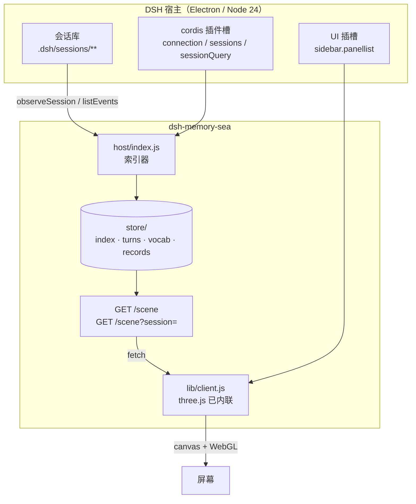
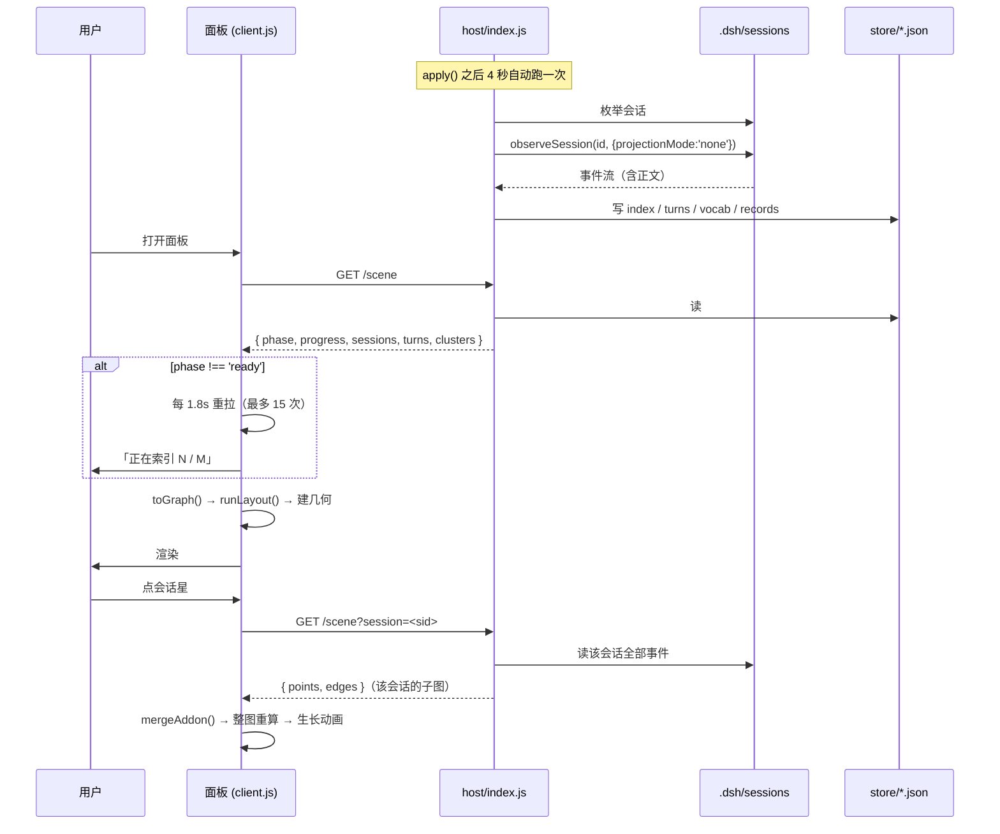
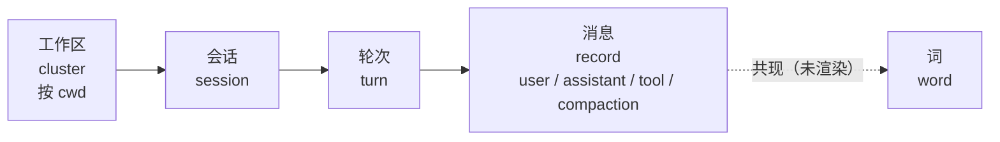
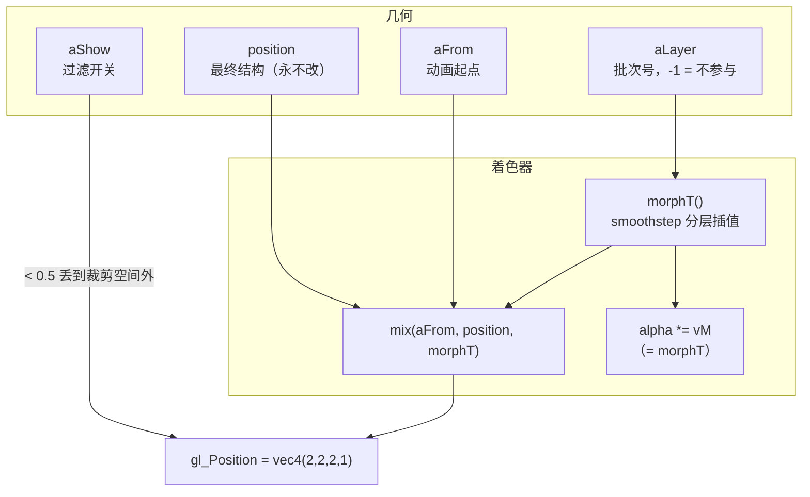
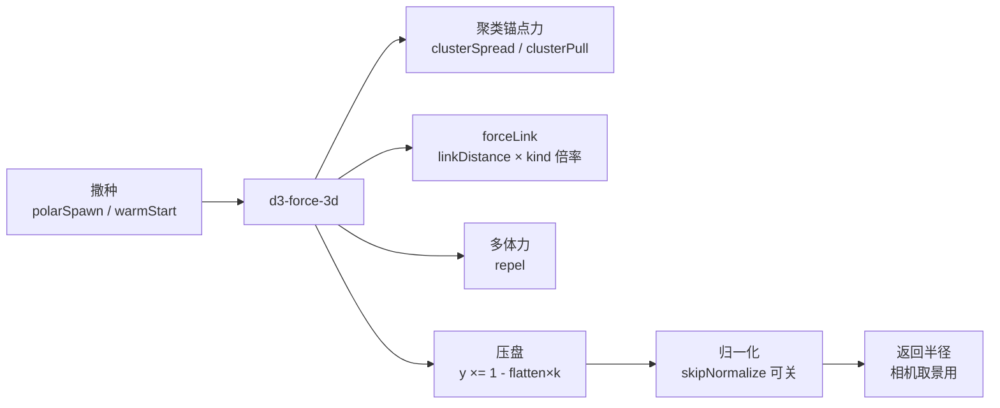
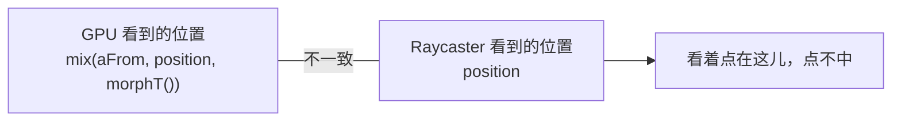
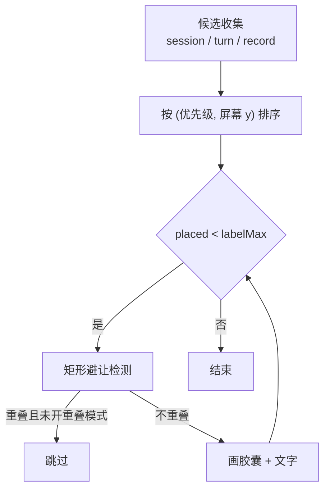
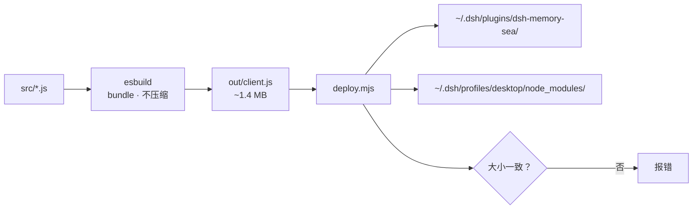

# 架构与技术交底

写给要改这个插件的人。读完应该能回答三个问题：
**数据从哪来、结构怎么算、像素怎么画**。

---

## 1. 整体形态

它不是一个独立应用，而是 DSH 的一个**面板插件**。



### 插件契约

一个 DSH 客户端插件必须满足三件事，缺一样就不加载：

```jsonc
// package.json
{
  "dsh": {
    "bundle": { "patch": "./cordis.patch.yml" },
    "client": { "platform": "web", "immediately": true }
  }
}
```

```js
// lib/client.js —— 必须走这个加载器，不能是普通 ESM
window.__ModuleLoader__.load({
  id: "dsh-memory-sea",
  factory: (require) => {
    const react = require("react");     // 只有 react 可以从宿主拿
    /* three.js 被 esbuild 内联进来了，不走 require */
    return { apply, inject: ["connection", "sessions"] };
  }
});
```

`PANEL_ID` 必须**同时**等于 `main.key` 和 `sidebar.panellist.id`，否则侧边栏点了没反应。

---

## 2. 数据流



### 为什么要轮询

索引器在 `apply()` 之后 4 秒才启动（避免拖慢宿主启动）。
面板如果只拉一次，正好赶上索引跑到一半 —— 拿到残缺图。
现在按 `phase` 轮询，`ready` 那一次用 `noGrow + keepCamera` **平滑替换**，
不重播入场动画、不动相机。

---

## 3. 四层结构



层级编号 `LAYER = { cluster:0, session:1, turn:2, record:3, word:4 }`，
用于动画分批、拾取优先、以及"向下走更深、向上走更浅"的高亮规则。

**索引全量、渲染分层**：`store` 里可以有几万条记录，
默认只画前三层，消息靠深探按需合并进场景。

---

## 4. 渲染管线



### 关键设计：position 永远是正确结构

动画不在 CPU 上搬点，全在 shader 里插值：

```glsl
attribute vec3 aFrom;
attribute float aLayer;
uniform float uMorphOn, uMorphT, uLayerCount, uLayerSpan;

float morphT() {
    if (uMorphOn < 0.5) return 1.0;
    if (aLayer < -0.5) return 1.0;                 // -1 = 不参与
    float n = max(uLayerCount, 1.0);
    float start = n > 1.5 ? aLayer * (1.0 - uLayerSpan) / (n - 1.0) : 0.0;
    float t = clamp((uMorphT - start) / max(uLayerSpan, 0.0001), 0.0, 1.0);
    return t * t * (3.0 - 2.0 * t);                // smoothstep
}

vec3 morphPosition(vec3 p) { return mix(aFrom, p, morphT()); }
```

点和线读**同一组 uniform**，所以不可能失步。每帧成本只有一个 float。

### 动画的三种形态

| 场景 | aFrom | aLayer | 观感 |
|---|---|---|---|
| **首次进入** | 全部 `vec3(0)` | 0 | 从一点炸开，分层散成星云 |
| **深探** | `= position` | 按批次 | 位置不动，新枝一束束亮起来 |
| **重排**（换预设） | 旧坐标 | 0 | 整体滑到新位置 |

深探那次 `aFrom === position` 是刻意为之：**结构先算完，动画只做透明度**。
否则用户能截到"一堆线正在慢慢拉开"的中间态 —— 那不是动画，是结构没算完。

---

## 5. 力导向布局



几个必须知道的点：

- **`warmStart` 保留坐标、不重新撒种**。换预设时点不会跳回随机位置再收回来。
- **`toGraph()` 每次新建节点，坐标是 `(0,0,0)`**。
  所以深探 rebuild 时必须在 `runLayout` **之前**把旧坐标回填，否则 `warmStart`
  保住的是全 0 —— 300 tick 从原点跑不开，结构会一直是一团。
- **`forceLink` 会把 `link.source/target` 从索引改写成对象**，
  所以代码里一律用 `nodeAt()` / `refIndex()` 取值，不能直接当下标用。
- 首次进入走 `stepwise`：跑 8 tick 就交出图，剩下每帧 26 tick，边算边画。

---

## 6. 拾取

`THREE.Raycaster` 不能用来点这些点。原因：



所以自己写屏幕空间拾取，**在 CPU 上重放同一个公式**：

```js
function visualPos(i, out) {
    const m = morphAt(layerA[i], u.uMorphOn.value, u.uMorphT.value,
                      u.uLayerCount.value, u.uLayerSpan.value);
    out.set(fromA[i3] + (posA[i3] - fromA[i3]) * m, /* … y, z */);
}

function pickAt(clientX, clientY) {
    if (readOnly) return -1;
    for (let i = 0; i < n; i += 1) {
        if (showA[i] < 0.5) continue;          // 被过滤的不可拾取
        visualPos(i, _pv);
        _proj.copy(_pv).project(camera);
        /* 转成 CSS 像素，取最近的，阈值 16px */
    }
}
```

`morphAt()` 是 `morphT()` 的 JS 等价实现，两边改一个必须同步改另一个。

---

## 7. 标签层

3D 里给几千个点画文字（sprite / canvas texture）会卡死，
所以叠一张独立的 2D canvas，`pointer-events: none`：



- 每 3 帧刷一次（文字不需要 60fps）
- 消息标签：有焦点时只标高亮那批；无焦点时**抽样**（上限 2000 个候选）
- 「允许重叠」模式跳过避让 —— 缩小时不丢标签，挤但都在

---

## 8. 宿主 API 的实测结论

| 想做的事 | 不能用 | 能用 |
|---|---|---|
| 注册 HTTP 接口 | `webServer.register`（那是静态路由） | `connection.fetch.register({ path, methods: [], requestBody: 'buffered', fetch })` |
| 读会话事件 | `listEvents({ sessionId })`（报 `[object Object] not found`） | `observeSession(sid, { projectionMode: 'none' })` |
| 在 `apply()` 里取服务 | `ctx.get('connection')`（还没就绪） | `ctx.inject(['connection'], cb)` + 重试 |
| 客户端发请求 | `window.dshDesktop`（没有网络能力） | `fetch('dsh-app://app/...')` |

字段名也踩过：注册接口时是 `fetch` **不是** `handler`，`methods` 必须是**数组**。

---

## 9. 模块职责

| 文件 | 行数 | 职责 |
|---|---|---|
| `host/index.js` | ~870 | 索引会话库、算词频、暴露 `/scene` |
| `src/render.js` | ~2400 | 着色器、动画、拾取、标签、过滤、相机 |
| `src/shell.js` | ~2400 | 面板 UI、设置页、工具栏、详情卡、排除元素 |
| `src/layout.js` | ~420 | 力导向布局、撒种、归一化 |
| `src/live.js` | ~230 | 真实数据 → scene |
| `src/deepdive.js` | ~200 | 单会话 → 子图，带 LRU 缓存 |
| `src/presets.js` | ~220 | 预设、配色、脏标记 |
| `src/scene.js` | ~90 | scene → graph（索引化） |

---

## 10. 构建



**不压缩**是刻意的：产物可读，滚动出错时能直接定位。
`deploy.mjs` 会检查 `src/*.js` 的 mtime，比 `out/client.js` 新就拒绝部署 ——
防止"改了源码但忘了构建，偷偷部署旧包"。

---

## 下一步（未做）

- 词共现层（`vocab.json` 已有 9825 个词，UI 未实现）
- 按子树规模调整层间距离（`linkDistance` 目前是 kind 固定倍率）
- 消息全文预览（现在只存前 200 字）
